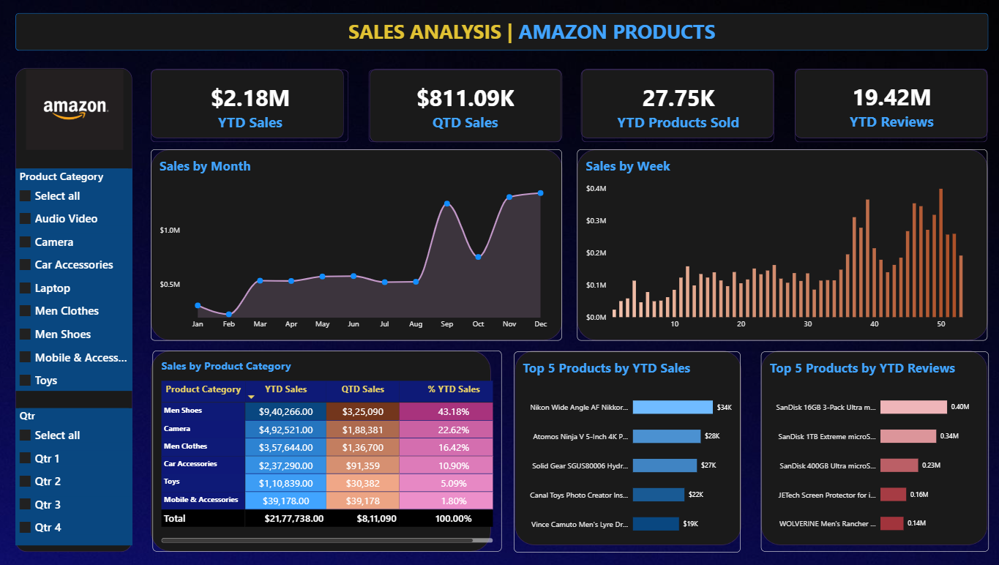

# 🛒 Amazon Products Sales Analysis Dashboard | Power BI

## 📌 Project Overview
Developed an interactive Power BI dashboard to analyze Amazon product sales, customer reviews, and sales performance across different product categories.

## 📊 Key Metrics
- **YTD Sales:** $2.18M
- **QTD Sales:** $811.09K
- **YTD Products Sold:** 27.75K
- **YTD Reviews:** 19.42M

## 📈 Dashboard Highlights
- Sales analysis by month and week.
- Sales performance by product category.
- Top 5 products by YTD Sales.
- Top 5 products by YTD Reviews.
- Interactive filters for Product Category and Quarter.
- KPI cards for quick performance tracking.

## 🛠️ Tools & Skills Used
Power BI | DAX | Power Query | Data Cleaning | Data Analysis | Data Visualization | Dashboard Development

## 📸 Dashboard Preview

